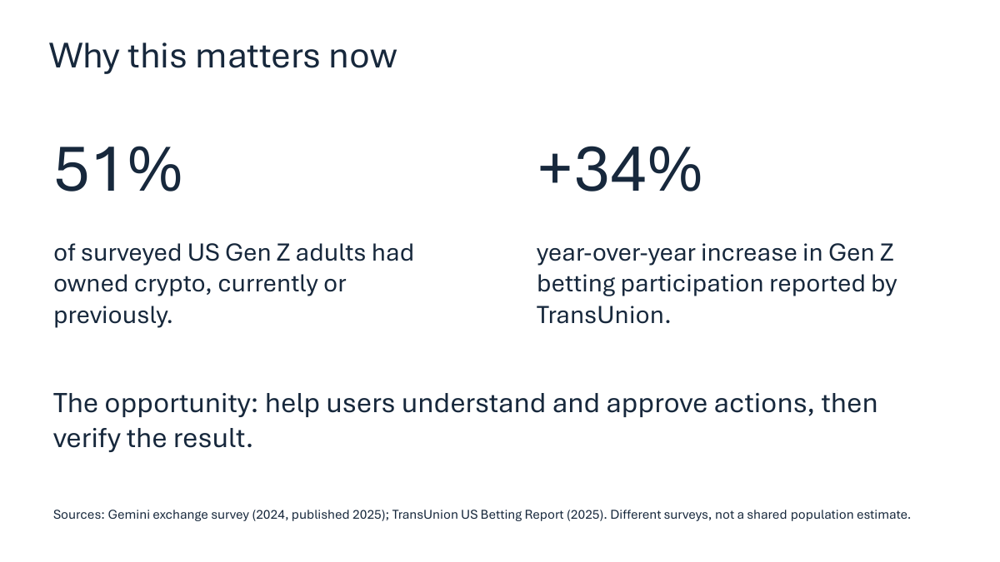
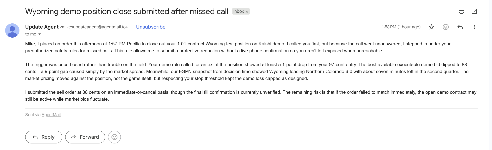
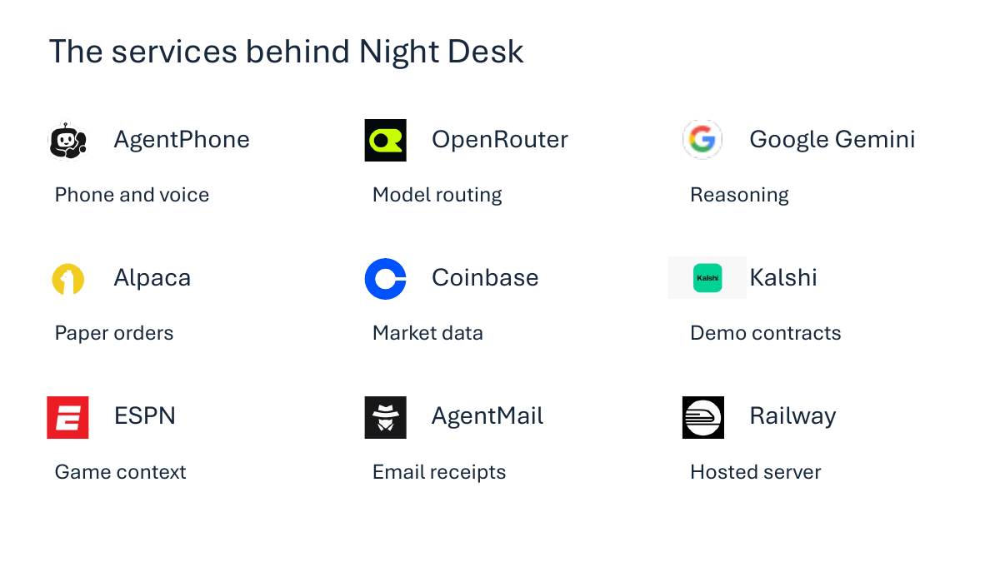

# Night Desk

## Understand the move. Make the call.

Night Desk connects your portfolio, your rules and your phone. When a position crosses a loss threshold, it calls with the market context ready. Ask what is happening, decide how much to reduce, and approve the action in your own words. Night Desk executes the trade and emails the result.

**Written rules · Market context · Voice approval · Trade receipts**

**[Watch the 80-second demo →](https://www.youtube.com/watch?v=1D13MW-iD_M)** · **[View the slides](https://drive.google.com/file/d/1JT6m-zExS88pWpNfdtetS9vlLt5U2QSi/view)** · [See the order and receipts](#the-order-and-the-receipts)

Built for the **Agents, Everywhere** hackathon using **Alpaca paper trading** and **Kalshi demo contracts**.

## Why Night Desk

A price alert tells you something changed. You still have to open your accounts, check your exposure, interpret the market and decide what to do. That work gets harder when you are away from your screen.

Night Desk brings those steps into one conversation. It knows the position you hold, the rule that triggered and the information behind the alert. You can ask about Bitcoin's direction, compare it with prediction-market odds, and approve a reduction during the same call.

Your written instructions also cover the missed-call path. With a pre-authorized reduction rule, Night Desk verifies that the call went unanswered, carries out the covered action and sends the explanation by email.

## Why this matters now



In Gemini exchange's 2024 survey, **51% of US Gen Z respondents currently owned or had previously owned crypto**. TransUnion reported **34% year-over-year growth in Gen Z betting participation in Q2 2025**. Sources: [Gemini exchange survey](https://www.gemini.com/blog/gemini-survey-finds-more-than-half-of-gen-z-owns-crypto%20) and [TransUnion report](https://newsroom.transunion.com/gen-z-millennial-speculators-drove-year-over-year-gambling-growth-in-q2-2025/).

Night Desk focuses on the decision after someone takes a position: understand the exposure, follow a written rule and carry the decision through to a recorded result.

## From a rule to a result

1. **Set your rules.** Choose the loss threshold, reduction amount and spending cap in the dashboard. Night Desk saves a version of your settings in its persistent Railway database.
2. **Get the call.** The server checks your holdings against the rule and brings your position, price moves, volume and market context into the conversation.
3. **Ask in plain English.** “Which way is Bitcoin trending?” “What is Kalshi pricing?” “What about my other positions?” Gemini answers from the context supplied by the server.
4. **Choose the action.** Add to an existing position, trim it or close it. The agent reads back the exact proposal and asks for approval. Adds follow your spending cap.
5. **Get the receipt.** Night Desk checks the broker's order result and writes an email explaining what it did, why it did it and how much exposure remains.


## Two ways to act

| You answer | You miss the call |
| --- | --- |
| Ask about the position and market context. | Night Desk verifies the unanswered-call outcome. |
| Request an action and hear the exact readback. | It applies the reduction already authorized by your written rule. |
| Approve the proposal by voice. | It keeps the action within the configured quantity and scope. |
| Receive the order result and explanation by email. | Receive the order result and explanation by email. |

The server enforces the approval, spending cap and available quantity. Saved order records prevent duplicate submissions and keep the receipt tied to the broker's result.

## Watch the Bitcoin workflow

Start with one rule: **call when Bitcoin falls 0.1% below entry, with a configured 10% reduction.**

In the recorded workflow, the owner follows up on the loss alert and asks:

> “What do Coinbase's price moves and trading volume say about Bitcoin's direction?”
>
> “What are the odds on Kalshi's current fifteen-minute Bitcoin market, and when does it settle?”

The owner then requests a **10% Bitcoin market trim**, hears the exact quantity and approves it. The Alpaca paper sell fills, and Night Desk sends an email explaining the completed reduction.

**Show the rule → Play the call → Show the filled order → Show the email.**

[Two-minute walkthrough](docs/DEMO_WALKTHROUGH.md)

## What we demonstrated

| Workflow | Result |
| --- | --- |
| **Answered Bitcoin call** | Market questions, spoken approval, a filled 10% Alpaca paper trim and an email receipt. |
| **Unanswered crypto call** | A verified missed call followed by a rule-authorized paper reduction. |
| **Unanswered Wyoming call** | The scoped Kalshi demo close filled and left zero contracts in that position. |

The demonstrations connect the conversation to stored call records, order results and email receipts.

## The order and the receipts

**Bitcoin: the approved market sell filled.**


**The email explains the completed 10% trim and the remaining exposure.**


**Wyoming: the missed-call rule carried out the authorized close.** The initial email records the submitted order and the reason for acting. Subsequent broker reconciliation confirmed the fill and zero remaining contracts.



## The tools behind the conversation



| Tool | What it brings to Night Desk |
| --- | --- |
| **Gemini through OpenRouter** | Interprets the conversation, explains supplied evidence and calls the server's tools. |
| **AgentPhone** | Places the call, transcribes speech and speaks the server's response. |
| **Alpaca paper** | Supplies crypto holdings and executes approved orders. |
| **Coinbase Exchange** | Supplies completed one-minute and five-minute price moves and relative trading volume. |
| **Kalshi** | Supplies Bitcoin prediction-market context and owned demo sports contracts. |
| **ESPN** | Adds game context for the configured football matchup. |
| **OpenRouter web search** | Answers explicit requests for current public research with source links. |
| **AgentMail** | Sends plain-English receipts built from stored execution facts. |
| **Railway + SQLite** | Runs the server and preserves rules, notes, conversations and order history. |

The server retrieves the context before supplying it to Gemini. Rules are edited in the Night Desk dashboard and stored on Railway.

## Try the conversation flow

Requires **Node.js 24+**. No third-party npm dependencies.

```sh
git clone https://github.com/msmalls54/night-desk.git
cd night-desk
npm test
npm start
```

Open **http://127.0.0.1:8876** and select **Start approval rehearsal**. Enter `yes, but only 25 percent`, then `25`, then a separate `yes` to see the revision and approval flow with synthetic contracts.

To connect your own accounts, follow the [setup guide](SETUP.md). Select your model through `OPENROUTER_MODEL`.

[Code and verification guide](docs/REVIEWER_GUIDE.md) · [Example rule and demo sequence](docs/DEMO_WALKTHROUGH.md) · [Presentation and image sources](docs/MEDIA.md)
