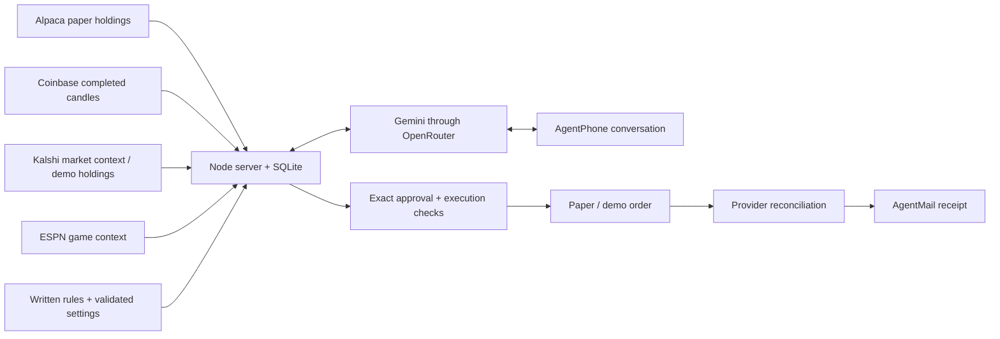

# Night Desk

**Demo/paper money only. Not investment advice.** Night Desk is a personal risk assistant that explains an existing position by phone, follows written rules, submits an approved paper trade, and emails a receipt from the broker's result.

Built for the September 12, 2026 Agents, Everywhere hackathon. The recorded demo asks about Coinbase's Bitcoin trend and Kalshi's fifteen-minute Bitcoin market, then approves a ten-percent trim on Alpaca paper.

## The working loop

1. The server retrieves actual holdings, price/volume readings and prediction-market context.
2. An eligible loss rule can initiate a phone call. AgentPhone handles speech; our server supplies Gemini's context and tools through OpenRouter.
3. The owner asks questions, requests a trim, hears the exact quantity and order type, then approves on a separate turn.
4. The server checks ownership, available quantity, open orders and approval before submitting once.
5. It reconciles the order and sends a plain-English email describing the actual result.



## Try it without credentials

Requires **Node.js 24 or later**. There are no third-party npm dependencies.

```sh
git clone https://github.com/msmalls54/night-desk.git
cd night-desk
npm test
npm start
```

Open **http://127.0.0.1:8876** and select **Start approval rehearsal**. Try `yes, but only 25 percent`, then `25`, then a separate `yes`. This rehearsal uses synthetic contracts and never calls a phone, model, broker or email provider. Missing connected accounts appear unavailable. Public market snapshots may load when the server has network access.

`npm test` runs eleven offline suites with network access blocked. It needs no credentials, broker account or running server.

## Connect your own providers

Copy `.env.example` to `.env`, supply your own credentials, and follow [SETUP.md](SETUP.md). Select the model with `OPENROUTER_MODEL`; there is no hardcoded model or silent fallback. The event deployment requested `google/gemini-3.8-flash` through OpenRouter.

New installations start with **execution paused, reduction rules unconfigured and adds disabled**. Saving a rule does not arm execution. `DEMO_RUN_ENABLED=true` and a future `DEMO_RUN_UNTIL` are both required for the bounded test window.

## What the agent can see

| Source | Supplied context |
| --- | --- |
| Alpaca paper | Existing BTC, ETH, SOL, XRP and DOGE quantities, entry, value, P&L, available quantities and open orders. Unrelated stocks are excluded. |
| Coinbase Exchange | Completed one-minute and five-minute returns; latest completed-minute volume divided by the preceding twenty completed-minute average. Venue volume only. Gaps, zero baselines and stale data are unavailable. |
| Kalshi public markets | The currently open fifteen-minute BTC interval, YES bid/ask-implied odds, closing time and settlement benchmark; separate bounded hourly coin context. Informational contracts do not establish ownership. |
| Kalshi demo | Actual owned YES/NO contracts and verified market names. Sports execution is restricted to the implemented game allowlist. |
| ESPN | The configured, identity-checked football matchup. It does not automatically describe every owned sports contract. |
| OpenRouter web search | Explicit public research requests, limited to one search and three results. Sources and retrieval times are saved. Ordinary price/position questions use supplied account and market data. |

The model cannot see dashboards, previous conversations or live feeds automatically. SQLite supplies explicit notes, recent completed calls, rule versions and stored execution facts.

## Authority and limits

- **Answered call:** a server-generated exact proposal and fresh approval are required. Changing the action requires a new readback. Repeated approval cannot resubmit an order.
- **Market trim/close:** Alpaca paper only, with an exact bounded quantity. No caller price or fresh bid/ask is required. Account/ownership checks remain; fill price is not guaranteed.
- **Adds:** only to an existing position, with an explicit amount, configured spending cap, limit price and approval. Disabled while the cap is blank.
- **Unanswered call:** only the specifically recognized carrier voicemail, a signed event and matching provider readback can authorize configured reductions. Unknown greetings, failures or human conversation do not qualify. Quiet hours alone never authorize an order.
- **Automatic reductions:** use rule-bound limit IOC orders, cumulative targets, expiring authority and durable submission claims. Uncertain results are reconciled, never blindly retried.
- **Sports:** the successful missed-call closeout was an explicitly scoped Wyoming demo test, not general autonomous sports trading.
- **Runtime:** one owner, one server replica and one persistent SQLite volume. This is not a multi-user trading service or a validated investment strategy.

## Verified during the event

The recorded final flow used the actual phone, Gemini, Coinbase and Kalshi context, then filled a ten-percent Alpaca paper market trim after spoken approval. The resulting email was accepted by the email provider. Earlier tests verified a rule-bound unanswered-call crypto reduction and a scoped Kalshi demo closeout. The owner confirmed the final video take was captured.

Provider acceptance is not proof of email delivery or opening. In the final call, the agent initially said the order outcome was unverified; the server subsequently reconciled the fill and emailed it. Private transcripts, account balances, credentials and raw receipts are intentionally not published.

See [the two-minute walkthrough](docs/DEMO_WALKTHROUGH.md) for the example rule and recording sequence, and [the reviewer guide](docs/REVIEWER_GUIDE.md) for the code tour and known limits.

## Event provenance

Application code was built in this project on September 12, 2026. Work began around 10:45 AM Pacific with organizer approval reported by the owner. Existing provider accounts, credentials, and a prior fixed-response phone transport check were reused infrastructure. This repository packages the application and offline verification; video upload and hackathon submission are separate owner-managed steps.
