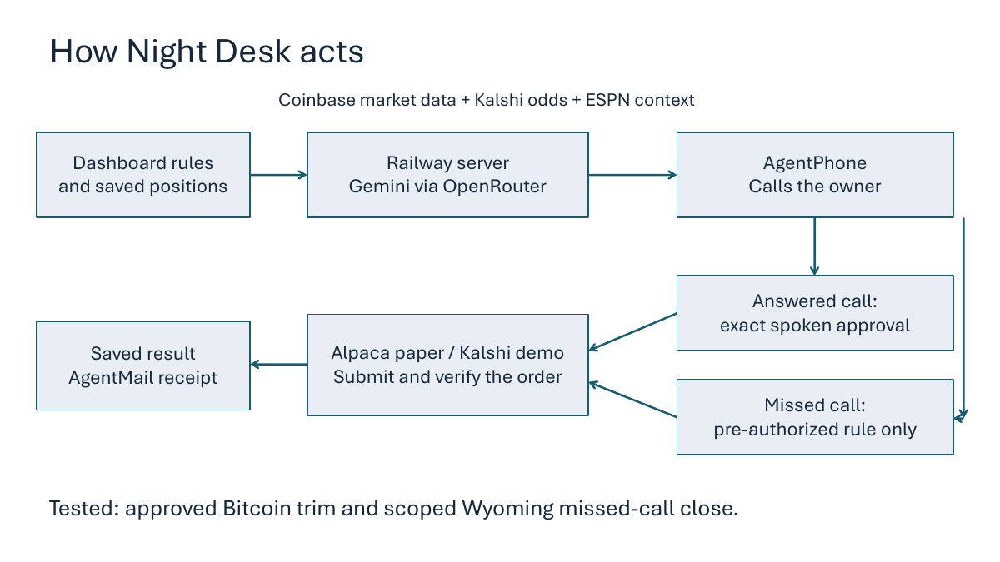

# Setup

**[Watch the demo](https://www.youtube.com/watch?v=1D13MW-iD_M)** · [View the slides](https://drive.google.com/file/d/1JT6m-zExS88pWpNfdtetS9vlLt5U2QSi/view) · [Product overview](README.md)

Night Desk runs the conversation, rules and execution checks in one Node server. This guide connects your providers to that workflow.

## Local review

Install Node.js 24+, run `npm test`, then `npm start`. The dashboard listens only on `127.0.0.1:8876`; phone ingress uses port `8765`. Local review works without credentials through the synthetic approval rehearsal. Do not expose the unauthenticated loopback dashboard to the internet.

Copy `.env.example` to `.env` when connecting providers. Environment variables override the file. Restart after configuration changes. Keep `.env`, keys and SQLite data out of Git.

## Provider configuration

1. **Alpaca:** use paper-account API credentials. Execution endpoints are fixed to `paper-api.alpaca.markets`. The application reads existing holdings; it does not seed a portfolio. Create any demo positions separately in your paper account.
2. **Kalshi:** set `KALSHI_ENV=demo`, a demo API key ID and either `KALSHI_PRIVATE_KEY_PATH` or `KALSHI_PRIVATE_KEY`. Public production market data is separately labeled context and cannot authorize a purchase.
3. **OpenRouter:** set your API key and explicit `OPENROUTER_MODEL`. Keep a provider spending cap. Search is on-demand, one request and up to three results; ordinary market/account questions do not search.
4. **AgentPhone:** read [the provider documentation](https://docs.agentphone.to/llms.txt). Configure an agent in webhook mode, assign a number, and route its signed webhook to `PUBLIC_URL/agentphone/turn`. Configure call-end events on the same ingress. Omit `systemPrompt` from outbound calls. Save the signing secret returned by webhook configuration. Use a 30-second webhook timeout; the application acknowledges promptly and has a 20-second model budget. The event used `voiceSpeed=1.2`, `interruptionSensitivity=0.2` and accurate transcription.
5. **Owner:** set `MY_PHONE` in E.164 format, `MY_EMAIL`, and optionally `OWNER_NAME`. Incoming voice turns are restricted to this configured owner.
6. **AgentMail:** supply an inbox and sending API key. Email uses stored action facts and verified provider outcomes. The published setup does not send a test message automatically.

Coinbase candles and public Kalshi market context require no API credentials. ESPN game mappings in `src/football-context.mjs` are specific, verified event examples; they are not general game discovery. Configure a new matchup only after verifying both provider identities and updating the execution allowlist and tests.

## Rules and a bounded run

The dashboard edits validated SQLite settings; `rules.md` describes the authority boundaries. On Railway, rules and history persist in `/data/nightdesk.sqlite`. The Google Sheet and Google service account are retired from this workflow. A fresh database starts with execution off; set the loss thresholds, reduction amounts and add spending cap in **Rules and preferences**. The recorded example used a **0.1% Bitcoin loss threshold** and a **10% reduction**.

- Save a loss threshold, cumulative reduction percentage, cooldown and maximum sale price concession for covered crypto reductions.
- Keep `DEMO_RUN_ENABLED=false` while reviewing. Saving settings alone cannot execute.
- For an explicitly intended test, set `DEMO_RUN_ENABLED=true` and `DEMO_RUN_UNTIL` to a future ISO UTC timestamp, then restart. Pause afterwards. The expiry is checked by the server independently of model output.
- Local `HOSTED=false` does not schedule monitoring. `HOSTED=true` runs the monitoring/receipt workers and requires persistent storage and dashboard authentication.
- An eligible rule can initiate one phone call. If answered, ask about the evidence and request a market trim; the next caller turn must approve the exact readback. Without an eligible rule, this project does not automatically place a briefing call.

The first-verified-unanswered-call path recognizes one tested carrier greeting. It is not a general voicemail detector. Unknown outcomes remain held. No repeated caller attempts are required for a valid scoped reduction, but no-answer never permits adding.

Optional `CRYPTO_DEMO_SCOPE_JSON` is for a separate, explicit one-time BTC rehearsal. Its fields are `id`, `symbol` (`BTCUSD`), `baseline_qty`, `starts_at`, and `expires_at`. Maximum duration is fifteen minutes. It preserves earlier ledgers and rejects reuse with changed rules or baseline. Leave it blank for the normal daily cycle. `SPORTS_DEMO_CLOSE_JSON` is a historical one-shot Wyoming test facility; leave it blank for a new installation.

## Hosting

The included Dockerfile copies only application source, public assets and rules. On Railway or another host, set `HOSTED=true`, `DATA_DIR=/data`, the host-provided `PORT`, `PUBLIC_URL` and a strong random `DASHBOARD_TOKEN` of at least 32 characters. Mount persistent storage at `/data` and keep **one replica**.

`/health` is public. The dashboard, state API and event stream require authentication in hosted mode. Browser access uses Basic auth with username `nightdesk` and the dashboard token as password; API clients use Bearer authentication. Never put the token in a URL or public frontend code. `/agentphone/turn` verifies provider signatures and owner identity separately.

Use `DEMO_RUN_ENABLED=false` for deployment and inspection. Configure secrets in the hosting platform, not the image or repository. The repository contains no hosted account configuration, private phone number, private dataset or shared credentials.
