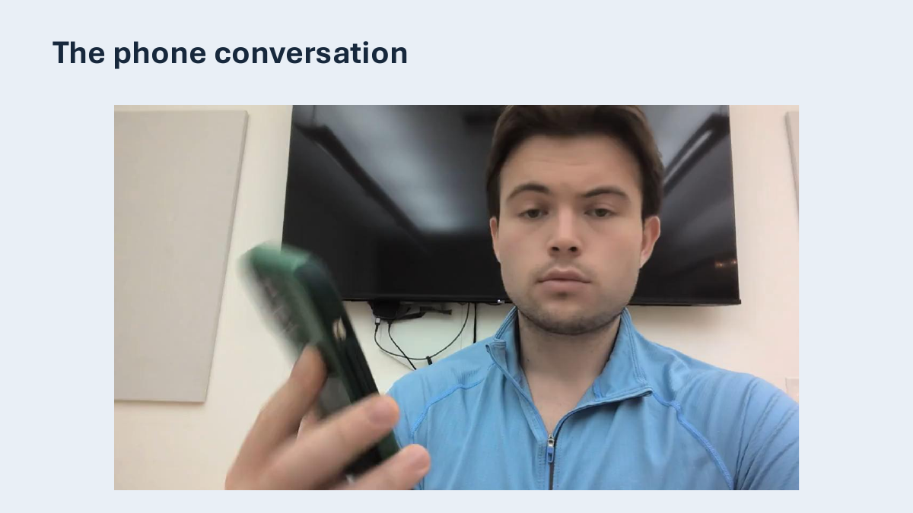
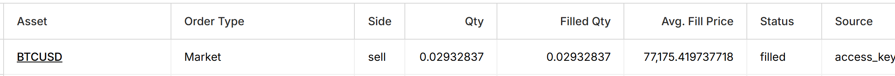
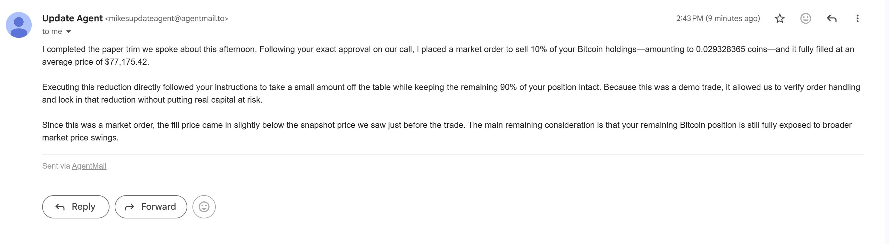

# Two-minute walkthrough

**[Play the 80-second recording](https://www.youtube.com/watch?v=1D13MW-iD_M)** · [Open the presentation](https://drive.google.com/file/d/1JT6m-zExS88pWpNfdtetS9vlLt5U2QSi/view)

Use one Bitcoin rule to show the complete loop: rule, conversation, filled order and email.

1. **Rule (about 15 seconds).** Open the connected Night Desk dashboard, then **Rules and preferences**. Show the **BTCUSD** row: **Loss percent: 0.1**, **Missed-call reduction: 10**. Say: "I set one Bitcoin protection rule: call me when my paper position falls 0.1 percent below entry. If I answer, I can discuss the evidence and approve a specific action."
2. **Conversation (about 75 seconds).** Show the recorded call. Ask: "What do Coinbase's price moves and trading volume say about Bitcoin's direction?" Then: "What are the odds on Kalshi's current fifteen-minute Bitcoin market, and when does it settle?" The recording then shows a ten-percent market trim request, exact readback and separate approval.
3. **Result (about 20 seconds).** Show the filled Bitcoin sell in the Alpaca paper account. Match the quantity and order to the receipt.
4. **Receipt (about 10 seconds).** Show the email explaining what was executed and why.

## Where the trigger came from

The saved rule compares **Alpaca paper unrealized percentage P&L** with **-0.1%**. The alert record from September 12, 2026 at **2:25:28 PM Pacific** records **-0.108%**, so it met the rule. Coinbase candle indicators and Kalshi odds supply discussion context; neither was the trigger for this example.

The owner answered the **2:25 PM** alert call. The successful final recording was a callback about that alert, and the approved paper order filled at **2:43 PM Pacific**. The missed-call Wyoming close was a separate test.

## Show the result

The creator's connected dashboard holds the example rule. A fresh clone starts with blank thresholds and execution off; use the local approval rehearsal to explore the interaction, or follow [Setup](../SETUP.md) to connect your own providers.
